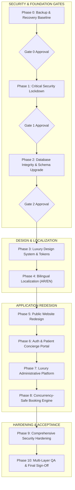
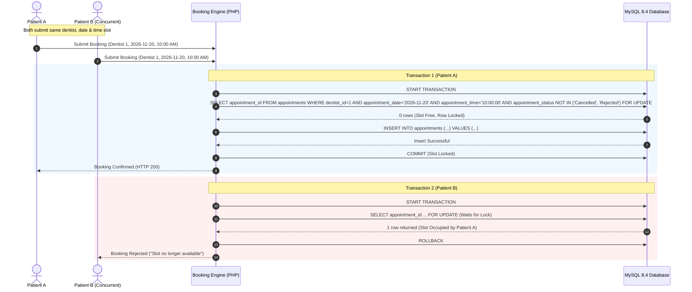

# DENTAL — COMPREHENSIVE IMPLEMENTATION ROADMAP
**End-to-End Product Engineering, Security Lockdown & Architecture Blueprint**

**Document Version:** `2.1.0-VALIDATED`  
**Brand:** `DENTAL` (Luxury Dental Experience)  
**Target Environment:** Windows 11 / WampServer 3.4.0 (Apache 2.4.65, PHP 8.3.28, MySQL 8.4.7)  
**Architecture:** Native Modular Procedural PHP 8.3 + MySQL 8.4 (PDO)  
**Status:** VALIDATED ARCHITECTURAL ROADMAP — DOCUMENTATION ONLY  

---

## 1. Master Execution Sequence & Dependency Architecture

The implementation sequence has been strictly structured to prioritize risk mitigation, data preservation, and operational stability.



---

## 2. Core Architectural & Database Principles

### 2.1 Database Integrity: Recurring Appointments vs. Email Uniqueness
- **CRITICAL CORRECTION APPLIED**:
  - `patients.patient_email` **MUST REMAIN UNIQUE**.
  - A patient is a discrete real-world person. A patient booking multiple visits does **NOT** require creating multiple duplicate patient records with the same email.
  - The architecture enforces a clean **1:N relational structure**:
    - `users` (1) ➔ `patients` (1) ➔ `appointments` (N).
  - When an authenticated or returning patient books an appointment, the engine looks up their single `patient_id` via `user_id` or `patient_email`. The new visit is inserted into `appointments` referencing that existing `patient_id`.
  - Infinite recurring appointments are supported with **zero duplicate patient records** and **full preservation of email uniqueness**.

### 2.2 Concurrency-Safe Appointment Scheduling Architecture
To prevent race conditions and simultaneous double-booking of the same doctor, date, and time slot, a two-layer defense is implemented:



#### Layer 1: Database Transactions & Pessimistic Locking (`FOR UPDATE`)
Every reservation execution wraps the slot availability check and insert in a strict database transaction (`SERIALIZABLE` or `READ COMMITTED` with `SELECT ... FOR UPDATE`). Conflicting concurrent requests are queued by the database engine; the second transaction reads the newly committed slot and aborts cleanly.

#### Layer 2: Database-Level Active Slot Uniqueness Key
To provide mathematical certainty at the database engine level (independent of application code), table `appointments` implements a stored generated column:
```sql
ALTER TABLE `appointments`
  ADD COLUMN `active_slot_key` VARCHAR(64) GENERATED ALWAYS AS (
    IF(`appointment_status` IN ('Cancelled', 'Rejected'), NULL, CONCAT(`dentist_id`, '_', `appointment_date`, '_', `appointment_time`))
  ) STORED,
  ADD UNIQUE KEY `idx_unique_active_slot` (`active_slot_key`);
```
- **How Cancelled Appointments Are Handled**:
  In MySQL, unique indexes permit multiple `NULL` values. If an appointment is cancelled or rejected, `active_slot_key` evaluates to `NULL`. The slot immediately becomes free for re-booking by any patient. Active appointments produce a non-null string (e.g., `'2_2026-11-20_10:00:00'`); any concurrent insert collision throws MySQL Error 1062 (Duplicate entry), preventing double-booking even under extreme race conditions.

---

### 2.3 Multi-Layer Secure File Upload Architecture
File uploads (such as avatars and dentist photographs) do not rely solely on web server configuration directives (`.htaccess`). A comprehensive, defense-in-depth pipeline is enforced:

```
  [Inbound Upload File]
           │
           ▼
  1. Size Restriction Validation (Max 2 MB enforced in PHP & HTML)
           │
           ▼
  2. Strict Extension Whitelist (.jpg, .jpeg, .png only - lowercase strict match)
           │
           ▼
  3. MIME Validation via finfo (Must match image/jpeg or image/png)
           │
           ▼
  4. Header & Magic Byte Validation (getimagesize() must verify valid image stream)
           │
           ▼
  5. Cryptographic Random Renaming (bin2hex(random_bytes(16)) . '.' . $ext)
           │
           ▼
  6. Image Stream Re-Encoding via GD (imagecreatefrom* -> image* to strip EXIF & PHP comments)
           │
           ▼
  7. Non-Executable Storage Destination (assets/uploads/ with php_flag engine off & Options -ExecCGI)
```

---

## 3. Detailed Phase-by-Phase Implementation Roadmap

---

### PHASE 0 — Backup and Recovery Baseline
**Objective**: Create a verifiable, bit-for-bit restore point before touching any project files or database records.

- **Scope**: Entire filesystem (`D:\wamp64\www\Dental`) and live MySQL database (`appointment_system`).
- **Dependencies**: None.
- **Tasks**:
  1. Create full directory ZIP backup: `D:\wamp64\Dental_backups\Dental_pre_remediation_[TIMESTAMP].zip`.
  2. Export full MySQL database using `mysqldump`: `D:\wamp64\Dental_backups\db_pre_remediation_[TIMESTAMP].sql`.
  3. Verify ZIP integrity by checking file count and testing extraction to a temporary directory.
  4. Verify SQL dump readability by inspecting table definitions and confirming presence of all 7 tables.
  5. Calculate and log SHA-256 cryptographic hashes for both backup files in `D:\wamp64\Dental_backups\checksums.txt`.
  6. Document step-by-step restoration procedure.
  7. **Restoration Testing Rule**: If recovery testing is performed, it **must** target an isolated temporary database (`appointment_system_test`) and **never** overwrite the active database.
- **Database Impact**: Zero. Strictly read-only dump.
- **Security Considerations**: Backup archives must be stored strictly outside the web server root.
- **Acceptance Criteria**: Both backup files exist, non-zero in size, with verified SHA-256 checksums.
- **Approval Gate 0**: Explicit approval required before proceeding to Phase 1.

---

### PHASE 1 — Critical Security Lockdown
**Objective**: Neutralize all P0/P1 attack surfaces identified in the forensic audits.

- **Scope**: `login/update_profile.php`, `admin/*.php`, `appointment_system.sql`, `admin/patient.php`, `admin/delete-*.php`.
- **Dependencies**: Phase 0 verified backup.
- **Tasks**:
  1. **Remediate RCE Upload**: Replace unconstrained upload logic in `login/update_profile.php` with the 7-layer upload validator. Deploy `.htaccess` in upload folders blocking script execution.
  2. **Enforce Administrative RBAC**: Prepend `auth_require_admin()` to all files in `admin/`. Ensure every `header("location: ...")` is followed by `exit;`. Ensure `login/login.php` sets `$_SESSION['role']`.
  3. **Relocate Database Dump**: Move `appointment_system.sql` from the web root to `D:\wamp64\Dental_backups\`. Add web root `.htaccess` rule blocking `.sql`, `.env`, and `.log` extensions.
  4. **Neutralize SQL Injections**: Convert `admin/patient.php` search and `admin/delete-*.php` ID handling to PDO prepared statements with bound parameters.
  5. **Remediate Password Storage & DOM Leak**: Remove hidden password input in `login/update_profile.php`. Authenticate old passwords via `password_verify()`. Hash new passwords via `password_hash($pass, PASSWORD_DEFAULT)`.
- **Database Impact**: Zero schema changes.
- **Security Considerations**: Completely eliminates Remote Code Execution and unauthenticated data destruction.
- **Acceptance Criteria**: Uploading a `.php` file returns HTTP 400; unauthenticated admin requests return 302 with 0 bytes body; SQL metacharacters in search execute as literal text.
- **Approval Gate 1**: Verification of Phase 1 patches required before database schema changes.

---

### PHASE 2 — Database Schema Integrity & Safe Migration
**Objective**: Modernize schema data types, establish relational constraints, prevent timestamp auto-overwrites, and preserve 100% of existing data.

- **Scope**: Tables `patients`, `appointments`, `users`, `dentists`, `services`.
- **Dependencies**: Phase 0 & Phase 1.
- **Pre-Migration Integrity Inspection (Verified Baseline)**:
  - Table `dentists`: 3 rows (Dr. Sara'a, Dr. BASSAM, Dr. Ali) — No foreign key issues.
  - Table `users`: 2 rows (Admin [ID 36], Mahmood [ID 41]) — Need unique constraint on `email`.
  - Table `patients`: 1 row (Mahmood [ID 32], email `bassccc@gmail.com`, phone `2147483647`).
  - Table `appointments`: 1 row (Appointment 18, Patient 32, Dentist 2, Service '2').
- **Exact Schema Changes**:
  1. `patients.phone_number`: Alter `INT(11)` ➔ `VARCHAR(20) NOT NULL`.
  2. `patients.user_id`: Add `INT NULL` column with foreign key `fk_patients_user_id` referencing `users(id)` ON DELETE SET NULL ON UPDATE CASCADE.
  3. `patients.ppassword`: Alter to `VARCHAR(250) NULL DEFAULT NULL`.
  4. **Preserve `patients.patient_email` uniqueness**: Unique constraint on `patient_email` is maintained.
  5. `appointments.appointment_date`: Alter `DATETIME` ➔ `DATE NOT NULL`.
  6. `appointments.appointment_time`: Alter `TIMESTAMP` ➔ `TIME NOT NULL DEFAULT '09:00:00'` (removes `ON UPDATE current_timestamp()`).
  7. `appointments.service_id`: Normalize `services` `VARCHAR(220)` ➔ `service_id INT NOT NULL` with foreign key referencing `services(service_id)`.
  8. `appointments.active_slot_key`: Add generated column and unique index for concurrency safety.
  9. `users.add_date`: Add default `CURRENT_TIMESTAMP`.
- **Data Reconciliation Query**:
  ```sql
  UPDATE patients p INNER JOIN users u ON p.patient_email = u.email SET p.user_id = u.id;
  ```
- **Validation Queries**: Confirm all 3 dentists, 2 users, 1 patient, and 1 appointment exist intact with valid foreign key relationships.
- **Rollback Strategy & Warning**: Reversible down script `database/002_schema_rollback.sql` provided.
  > [!WARNING]
  > Executing rollback after new appointments have been booked in production could lose new slot keys and revert phone numbers to 32-bit INT. Rollback is intended solely for pre-production disaster recovery.
- **Acceptance Criteria**: Schema matches target architecture; zero data lost; phone numbers accept 15+ digits; appointment times do not auto-update on status change.
- **Approval Gate 2**: Database validation verified before UI construction begins.

---

### PHASE 3 — Luxury Brand Identity & Design System
**Objective**: Build the foundational CSS design tokens, typography system, and responsive component library from scratch.

- **Scope**: `assets/css/variables.css`, `assets/css/style.css`, `assets/css/style.rtl.css`.
- **Dependencies**: Phase 2.
- **Tasks**:
  1. Implement color tokens: Deep Emerald (`#123D36`), Forest Green (`#1B5146`), Champagne Gold (`#C6A46A`), Soft Gold (`#DCC69D`), Warm Ivory (`#FAF8F3`), Charcoal (`#252927`).
  2. Configure dual font pairing: `Cormorant Garamond` (EN Display) + `Plus Jakarta Sans` (EN Body) paired with `Tajawal` & `Cairo` (Arabic Display & Body).
  3. Construct base components: `.btn-luxury-primary`, `.btn-luxury-outline`, `.luxury-card`, `.luxury-input`, status badges, and direction-flipping icons.
  4. Build Bootstrap 5 layout integration with full CSS logical properties (`margin-inline-start`, etc.).
- **Acceptance Criteria**: CSS design tokens pass WCAG AA contrast checks; typography renders without font-popping; components render cleanly in both LTR and RTL.

---

### PHASE 4 — Bilingual Localization Engine (Arabic & English)
**Objective**: Build a robust, zero-dependency translation engine supporting English (default) and Arabic RTL.

- **Scope**: `includes/localization.php`, `languages/en.php`, `languages/ar.php`.
- **Dependencies**: Phase 3.
- **Tasks**:
  1. Author `includes/localization.php` with translation helpers `__($key)` and `_e($key)`.
  2. Compile comprehensive translation dictionaries in `languages/en.php` and `languages/ar.php` covering 100% of user interface strings.
  3. Implement persistent language switcher (session + 30-day cookie).
  4. Ensure dynamic document attributes: `<html lang="en" dir="ltr">` with `bootstrap.min.css` vs `<html lang="ar" dir="rtl">` with `bootstrap.rtl.min.css`.
- **Acceptance Criteria**: Switching language updates 100% of on-screen text; zero mixed-language elements; RTL layout mirrors correctly.

---

### PHASE 5 — Public Website Redesign
**Objective**: Build the public luxury web pages from scratch using authentic project data.

- **Scope**: `index.php`, `about.php`, `services.php`, `dentists.php`, `dentist_info.php`, `contact.php`.
- **Dependencies**: Phase 3 & Phase 4.
- **Tasks**:
  1. Build Luxury Homepage (`index.php`): Editorial hero, verified doctor profiles, verified services from DB, truth-in-information commitments, booking CTA.
  2. Build About Us (`about.php`): Clinic introduction sourced from table `about_us`, medical philosophy, sterilization standards.
  3. Build Services Catalog (`services.php`): Procedures and pricing from table `services` with direct booking links.
  4. Build Specialists Directory (`dentists.php` & `dentist_info.php`): Doctor bios (`dentist_brief`) and credentials for Dr. Sara'a, Dr. BASSAM, and Dr. Ali.
  5. Build Contact Us (`contact.php`): Inquiry form submitting to table `contact_us` via prepared statements, clear placeholders for unverified address/phone.
- **Acceptance Criteria**: All 6 pages render with 100% luxury styling; responsive across desktop/tablet/mobile; zero broken links.

---

### PHASE 6 — Authentication & Patient Concierge Portal
**Objective**: Construct secure authentication and an isolated patient self-service dashboard.

- **Scope**: `login.php`, `register.php`, `logout.php`, `patient/*.php`.
- **Dependencies**: Phase 2, Phase 4, Phase 5.
- **Tasks**:
  1. Build luxury sign-in and registration pages with Bcrypt hashing and session regeneration.
  2. Build Patient Dashboard (`patient/index.php`): Next appointment card, booking CTA, medical history summary.
  3. Build "My Appointments" (`patient/appointments.php`): Filterable tabs (Upcoming, Completed, Cancelled).
  4. Build Profile & Security Center (`patient/profile.php`, `patient/security.php`): Update phone number, validated avatar upload, secure password change.
  5. Enforce strict patient tenant isolation: Every query scoped to `WHERE user_id = :session_user_id`.
- **Acceptance Criteria**: Patient can log in, view only their own appointments, update profile, and change password without errors.

---

### PHASE 7 — Luxury Administrative Platform
**Objective**: Construct an executive operations platform replacing all legacy eDoc code.

- **Scope**: `admin/index.php`, `admin/appointments.php`, `admin/patients.php`, `admin/dentists.php`, `admin/services.php`, `admin/messages.php`, `admin/settings.php`.
- **Dependencies**: Phase 2, Phase 4, Phase 6.
- **Tasks**:
  1. Build Executive KPI Dashboard (`admin/index.php`): Real-time metrics calculated from database, today's schedule table.
  2. Build Appointment Operations (`admin/appointments.php`): Multi-column filtering by date/doctor/status, status workflow updater.
  3. Build Patient Health Directory (`admin/patients.php`): Directory search via prepared statements, appointment history view.
  4. Build Dentist Management (`admin/dentists.php`): Specialist CRUD with validated photo uploads.
  5. Build Treatment Management (`admin/services.php`): Service catalog and fee manager.
  6. Build Patient Inquiry Inbox (`admin/messages.php`): View and manage contact messages.
- **Acceptance Criteria**: All 7 admin modules operate with zero PHP warnings; non-admin users cannot access any module; no dead/unconnected buttons.

---

### PHASE 8 — Advanced Appointment Booking & Business Workflows
**Objective**: Implement the concurrency-safe, multi-step luxury booking engine.

- **Scope**: `booking.php`, `modules/appointments/*.php`.
- **Dependencies**: Phase 2, Phase 6, Phase 7.
- **Tasks**:
  1. Build guided booking UI: Step 1 (Service), Step 2 (Dentist), Step 3 (Date/Time Slot), Step 4 (Patient Details), Step 5 (Confirmation).
  2. Implement concurrency-safe booking transaction: `SELECT ... FOR UPDATE` wrapped in transaction + `active_slot_key` duplicate prevention.
  3. Enable recurring appointments: Look up existing `patient_id` by `user_id` or `patient_email`; reuse existing patient record.
  4. Dynamic doctor selection: User selects dentist from dynamic `<select>` populated from table `dentists`.
  5. Cancellation workflow: Allow patients to cancel upcoming appointments up to policy cutoff.
- **Acceptance Criteria**: Returning patients can book multiple appointments; concurrent simulation of duplicate slot booking successfully rejects second request; slot becomes re-bookable upon cancellation.

---

### PHASE 9 — Comprehensive Security Hardening
**Objective**: Enforce defense-in-depth across the entire application stack.

- **Scope**: Entire codebase, `.htaccess`, `includes/security.php`.
- **Dependencies**: Phases 1–8.
- **Tasks**:
  1. Enforce anti-CSRF token verification on all POST requests. Convert all deletion actions to POST.
  2. Wrap all dynamic outputs in context-aware escaping `e()`.
  3. Deploy HTTP security headers (`X-Frame-Options`, `X-Content-Type-Options`, `Referrer-Policy`).
  4. Configure silent error logging: Catch PDO exceptions and log to file; display user-friendly error banners.
  5. Implement rate limiting on login endpoint (max 5 failed attempts per 15 minutes).
- **Acceptance Criteria**: CSRF tampering returns HTTP 403; XSS payloads render as harmless escaped text; zero database error strings visible to users.

---

### PHASE 10 — Integration, Multi-Layer Testing & Final QA Gate
**Objective**: Rigorous verification across security, functionality, and bilingual rendering before production delivery.

- **Scope**: Entire system.
- **Dependencies**: Phases 0–9.
- **Testing Protocol**:
  1. **PHP Syntax Audit**: Execute `php -l` across 100% of PHP files.
  2. **Security Regression Suite**: Verify RCE blocked, SQL injection blocked, IDOR blocked, admin bypass blocked.
  3. **Concurrency Stress Test**: Execute parallel curl/PowerShell requests attempting simultaneous booking of the same slot.
  4. **Bilingual Visual QA**: Inspect all pages in both English (LTR) and Arabic (RTL) across desktop, tablet, and mobile breakpoints.
  5. **Data Preservation Verification**: Confirm all initial records (dentists, test users, services, about text) are present and intact.
- **Acceptance Criteria**: 100% pass on syntax, security, functional, and bilingual visual checks.

---

## 4. Final Engineering Review & Open Decisions

The following items are documented as engineering assumptions or items requiring explicit clinic owner validation before Phase 5 deployment:

| Decision / Parameter | Current Technical Status | Required Owner Action |
| :--- | :--- | :--- |
| **Clinic Operating Hours** | Not present in existing database | Confirm weekly clinic schedule (e.g., Sat–Thu, 9:00 AM – 9:00 PM). |
| **Verified Contact Phone** | Existing footer contained sample `+967 777 000 999` | Confirm official clinic telephone number for public display. |
| **Verified Clinic Address** | Not present in existing database | Provide physical clinic street address and city. |
| **Expanded Services & Pricing** | Existing database contains only 2 treatments (Cleaning, Surgery) | Confirm whether additional clinical procedures should be seeded into `services`. |
| **Default Appointment Slot Length** | Not defined in database schema | Confirm whether default clinical slots should be 30, 45, or 60 minutes. |
| **Cancellation Cutoff Window** | Not defined in business logic | Confirm minimum hours required before appointment time for patient self-cancellation (e.g. 24 hours). |

---

> [!IMPORTANT]
> **Execution Status**: This implementation roadmap is strictly a **planning specification**. In accordance with instructions, **no application code or database records have been modified**. Review this plan and authorize Phase 0 when ready.
