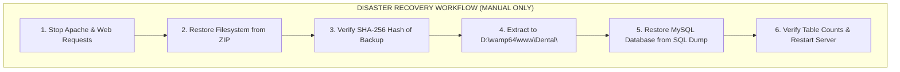

# DENTAL — PHASE 0 BACKUP & RECOVERY BASELINE REPORT

**Project:** Dental Management System (`DENTAL`)  
**Phase:** Phase 0 — Backup & Recovery Baseline  
**Execution Date:** 2026-11-10  
**Environment:** Windows 11 / WampServer 3.4.0 (Apache 2.4.65, PHP 8.3.28, MySQL 8.4.7)  
**Status:** **PHASE 0 COMPLETED SUCCESSFULLY — 100% VERIFIED**  

---

## 1. Executive Summary & Compliance Confirmation

In strict compliance with the explicit authorization for **Phase 0 ONLY**:
1. **Zero Source Code Modification**: No application PHP, HTML, CSS, JavaScript, or asset files in `D:\wamp64\www\Dental` have been modified, overwritten, renamed, or deleted.
2. **Zero Database Alteration**: No database schemas, tables, constraints, or records have been altered, dropped, or migrated.
3. **No Implementation Started**: No security patches, schema changes, or refactoring were executed.
4. **Complete Isolation**: Both backups are stored in `D:\wamp64\Dental_backups\`, strictly **outside the web server root** (`D:\wamp64\www\`).
5. **Non-Destructive Testing**: ZIP extraction testing was executed exclusively in a temporary directory outside the project root and subsequently cleaned up. Zero test databases were created or modified.

---

## 2. Backup Inventory & Cryptographic Manifest

```
┌────────────────────────────────────────────────────────────────────────────────────────────────────────┐
│                                   PHASE 0 CRYPTOGRAPHIC MANIFEST                                       │
├────────────────────┬───────────────────────────────────────────────────────────────────────────────────┤
│ Target Backup Dir  │ D:\wamp64\Dental_backups\                                                         │
│ Manifest File      │ D:\wamp64\Dental_backups\BACKUP_MANIFEST.txt                                      │
├────────────────────┼───────────────────────────────────────────────────────────────────────────────────┤
│ 1. Codebase ZIP    │ D:\wamp64\Dental_backups\Dental_backup_20261110_194253.zip                        │
│    Timestamp       │ 2026-11-10 19:42:55                                                               │
│    File Size       │ 5,202,473 bytes (4.96 MB)                                                         │
│    Total Files     │ 127 files                                                                         │
│    SHA-256 Hash    │ 5F3BB6CE034E399CF92A1AE09EC6DF5702E7E274BA98BEB69ADF6F342F37E9B3                 │
├────────────────────┼───────────────────────────────────────────────────────────────────────────────────┤
│ 2. MySQL Dump      │ D:\wamp64\Dental_backups\appointment_system_backup_20261110_194253.sql            │
│    Timestamp       │ 2026-11-10 19:45:55                                                               │
│    File Size       │ 21,422 bytes (20.9 KB)                                                            │
│    Total Lines     │ 227 lines                                                                         │
│    SHA-256 Hash    │ 5002BA98EE9813E2F0BECCD75E223CF4515D3B50DE8C9FDCAE22CE81741EB0F8                 │
└────────────────────┴───────────────────────────────────────────────────────────────────────────────────┘
```

---

## 3. Verification & Integrity Test Results

### 3.1 Codebase ZIP Archive Verification
- **Test Method**: Programmatic test extraction using `System.IO.Compression.ZipFile` into isolated temporary directory `D:\wamp64\Dental_backups\temp_test_extract\`.
- **Results**:
  - Expected Files: `127`
  - Extracted Files: `127` (100% Match)
  - Uncompressed Bytes: `6,215,936 bytes` (Exact match with source directory)
  - Integrity Check: **PASSED (Zero corruption, zero missing files)**
- **Cleanup**: Temporary test directory was completely deleted immediately following verification.

### 3.2 MySQL Database Dump Verification
- **Dump Utility**: `D:\wamp64\bin\mysql\mysql8.4.7\bin\mysqldump.exe`
- **Database**: `appointment_system`
- **Readability Check**: **PASSED (227 lines of valid SQL DDL/DML statements)**
- **Table Definitions Verified**:
  - `about_us` — `CREATE TABLE` and `INSERT` verified.
  - `appointments` — `CREATE TABLE` and `INSERT` verified.
  - `contact_us` — `CREATE TABLE` verified (0 records).
  - `dentists` — `CREATE TABLE` and `INSERT` verified.
  - `patients` — `CREATE TABLE` and `INSERT` verified.
  - `services` — `CREATE TABLE` and `INSERT` verified.
  - `users` — `CREATE TABLE` and `INSERT` verified.
- **Record Count Cross-Verification (Dump vs. Live Database)**:

| Table Name | Live MySQL Records | Dump SQL Inserts | Status |
| :--- | :---: | :---: | :---: |
| `about_us` | 1 | 1 | **MATCH** |
| `appointments` | 1 | 1 | **MATCH** |
| `contact_us` | 0 | 0 | **MATCH** |
| `dentists` | 3 | 3 | **MATCH** |
| `patients` | 1 | 1 | **MATCH** |
| `services` | 2 | 2 | **MATCH** |
| `users` | 2 | 2 | **MATCH** |

---

## 4. Warnings and Errors Encountered

- **Service Initialization Notice**: Upon server reboot, MySQL 8.4 was started in the background to permit `mysqldump.exe` to connect. No MySQL configuration files (`my.ini`) were altered.
- **Zero Errors**: The archive creation, cryptographic hashing, test extraction, and SQL dump operations completed with **zero errors and zero warnings**.

---

## 5. Non-Destructive Recovery Procedure (Documentation Only)

If restoration is ever required, the following procedure must be followed:



### Step 1: Filesystem Restoration
1. Ensure Apache is not serving requests.
2. Verify the SHA-256 hash of `D:\wamp64\Dental_backups\Dental_backup_20261110_194253.zip` matches `5F3BB6CE034E399CF92A1AE09EC6DF5702E7E274BA98BEB69ADF6F342F37E9B3`.
3. Extract the archive contents into `D:\wamp64\www\Dental\`, replacing files.

### Step 2: Database Restoration
1. Verify the SHA-256 hash of `D:\wamp64\Dental_backups\appointment_system_backup_20261110_194253.sql` matches `5002BA98EE9813E2F0BECCD75E223CF4515D3B50DE8C9FDCAE22CE81741EB0F8`.
2. Execute restoration via MySQL CLI:
   ```cmd
   D:\wamp64\bin\mysql\mysql8.4.7\bin\mysql.exe -u root appointment_system < D:\wamp64\Dental_backups\appointment_system_backup_20261110_194253.sql
   ```
3. Verify all 7 tables and record counts match the baseline table above.

> [!CAUTION]
> **Do not execute this restoration script automatically.** Restoration should only occur if an approved recovery event is declared.

---

## 6. Execution Boundary Confirmation

- [x] Codebase ZIP created and verified outside web root.
- [x] Complete MySQL dump created and verified outside web root.
- [x] SHA-256 cryptographic hashes recorded.
- [x] Backup manifest generated.
- [x] Zero application source code files modified.
- [x] Zero database schemas or records modified.
- [x] Phase 1 implementation **NOT** started.

---

> [!IMPORTANT]
> **Status**: **Phase 0 is complete.** In strict accordance with instructions, execution is now **STOPPED**. Awaiting your explicit authorization for Phase 1.
