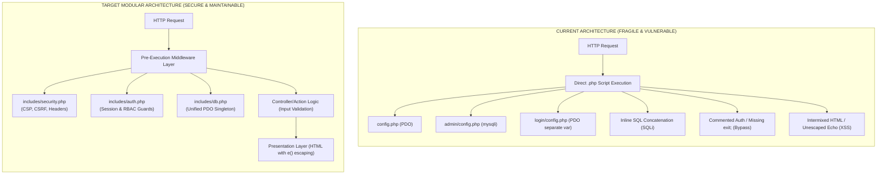
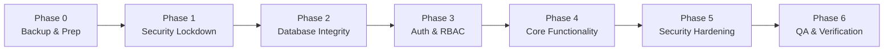
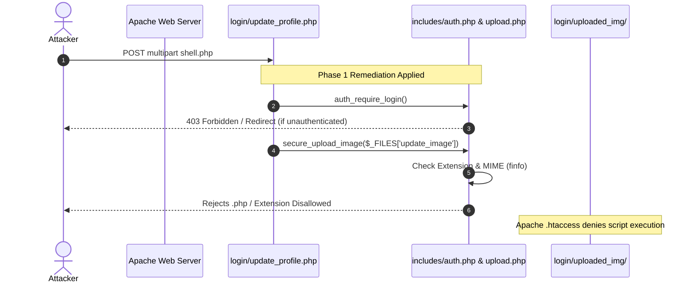
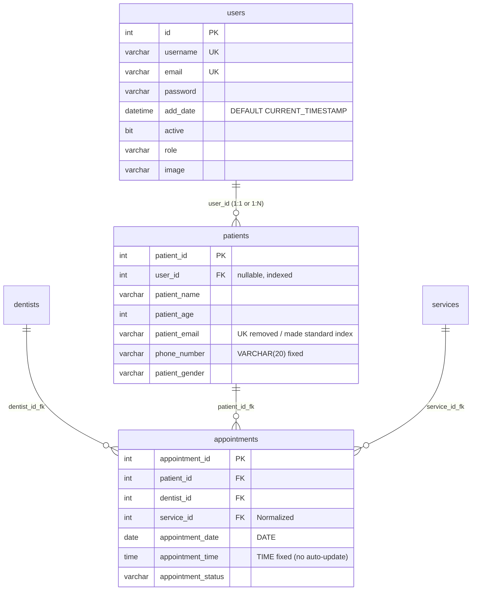
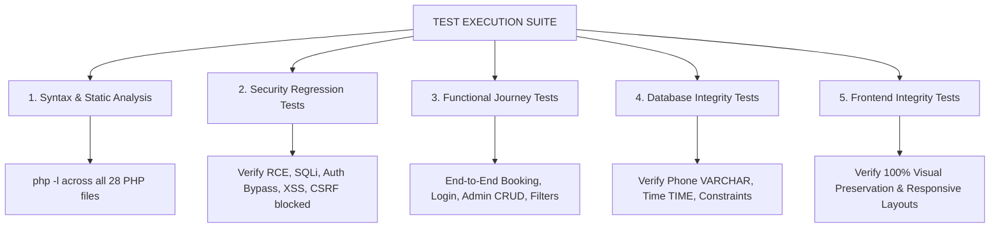

# DENTAL MANAGEMENT SYSTEM — MASTER REMEDIATION PLAN

**Document ID:** `ENG-REM-2026-DENTAL-01`  
**Classification:** Engineering Specification & Security Remediation Roadmap  
**Target Environment:** Windows 11 / WampServer 3.4.0 (Apache 2.4.65, PHP 8.3.28, MySQL 8.4.7)  
**Status:** DRAFT — PENDING APPROVAL  

---

## 1. Executive Context & Architectural Baseline

### 1.1 Project Preservation Constraints
- **Visual Identity Preservation**: The existing frontend styling, layouts, color schemes, typography, CSS classes, images, and user journey aesthetics must remain intact.
- **Framework Constraint**: No heavy framework replacements (Laravel, Symfony, Yii). The application will remain a lightweight, high-performance procedural PHP application.
- **Architectural Evolution**: Transition from unstructured procedural PHP to a **Modular Procedural Architecture** incorporating centralized database abstraction, reusable security middleware, robust error handling, and strict input/output sanitization.
- **Zero Data Loss**: All existing records (dentists, test patients, users, appointments) must be preserved and safely migrated.

---

## 2. Current vs. Target Architecture



### 2.1 Architectural Comparison

| Dimension | Current Architecture | Target Modular Architecture |
| :--- | :--- | :--- |
| **Code Organization** | Flat scripts with intermixed SQL, HTML, and sessions. | Discrete separation: Logic / Action at top, Presentation at bottom. |
| **Database Access** | 3 conflicting config files (`PDO` vs `mysqli`). | Single centralized PDO instance (`includes/db.php`) with strict exceptions. |
| **Authentication** | Broken session variables (`$_SESSION['user_id']`), commented guards. | Centralized auth guards (`require_login()`, `require_admin()`) with enforced `exit;`. |
| **Security Controls** | No CSRF tokens, no CSP headers, unescaped echoes. | Centralized CSRF generation/validation, security headers, context-aware escaping. |
| **File Uploads** | Direct unvalidated moves to web-accessible folders. | Strict MIME/extension whitelist, random UUID filenames, script execution disabled. |
| **Error Handling** | Raw exception strings leaked to browser (`die($e->getMessage())`). | Centralized logger; sanitized, user-friendly error banners. |

---

## 3. Core Foundation Libraries (Shared Infrastructure)

To maintain procedural simplicity without code duplication, five core lightweight helper modules will be established in `includes/`:

```
D:\wamp64\www\Dental\
└── includes/
    ├── db.php             # Unified PDO connection (Singleton / strict UTF-8)
    ├── auth.php           # Session initialization, RBAC guards, user helpers
    ├── security.php       # CSRF tokens, security headers, output escaping e()
    ├── validation.php     # Input validation (email, phone, dates, types)
    └── upload.php         # Secure file upload validator & processor
```

### 3.1 Infrastructure Specifications

#### `includes/db.php`
- Enforces strict UTF-8 (`utf8mb4`).
- Configures `PDO::ATTR_ERRMODE => PDO::ERRMODE_EXCEPTION`.
- Configures `PDO::ATTR_DEFAULT_FETCH_MODE => PDO::FETCH_ASSOC`.
- Configures `PDO::ATTR_EMULATE_PREPARES => false`.
- Traps connection exceptions; logs to PHP system log without exposing credentials.

#### `includes/auth.php`
- Initializes secure sessions with strict cookie parameters (`httponly`, `samesite=Strict`, `secure` if HTTPS).
- `auth_require_login()`: Ensures user is logged in; redirects to `login/login.php` with `exit;`.
- `auth_require_admin()`: Verifies `$_SESSION['role'] === 'admin'`; redirects unauthorized users with `exit;`.
- `auth_current_user()`: Returns cached array of the authenticated user's profile.

#### `includes/security.php`
- `e($string)`: Shorthand for `htmlspecialchars($string ?? '', ENT_QUOTES, 'UTF-8')`.
- `csrf_token()`: Generates and stores a cryptographic 256-bit anti-CSRF token in session.
- `csrf_field()`: Outputs hidden HTML input with the active CSRF token.
- `csrf_verify()`: Validates incoming POST token; halts invalid requests with HTTP 403.
- `send_security_headers()`: Sets `X-Frame-Options: SAMEORIGIN`, `X-Content-Type-Options: nosniff`, `Referrer-Policy: strict-origin-when-cross-origin`.

#### `includes/upload.php`
- Strictly validates file extensions against a whitelist (`jpg`, `jpeg`, `png`).
- Validates binary magic bytes using `finfo_file(FILEINFO_MIME_TYPE)`.
- Replaces original client filenames with cryptographically random hashes (`bin2hex(random_bytes(16)) . '.' . $ext`).
- Rejects files exceeding 2 MB.

---

## 4. Phase-by-Phase Remediation Roadmap



---

### PHASE 0 — Backup and Recovery Preparation
**Objective**: Establish a non-destructive restoration baseline before any code or schema alterations.

| Task ID | Task Description | Affected Targets | Technical Implementation | Validation Method |
| :--- | :--- | :--- | :--- | :--- |
| **T0.1** | Full Filesystem Snapshot | Entire project directory | Create verified zip archive `Dental_backup_pre_remediation.zip` outside web root (`D:\wamp64\Dental_backups\`). | Verify zip checksum and archive structure. |
| **T0.2** | Full Database Dump Snapshot | `appointment_system` database | Execute `mysqldump -u root appointment_system > D:\wamp64\Dental_backups\db_backup_pre_remediation.sql`. | Inspect SQL dump file size and table definitions. |
| **T0.3** | Automated Rollback Script | Backup files | Script `rollback_pre_remediation.bat` to restore database and codebase in under 60 seconds if needed. | Dry-run syntax check of rollback script. |

---

### PHASE 1 — Critical Security Lockdown (P0)
**Objective**: Eliminate active remote code execution, unauthorized admin access, and public database exposure.



#### Detailed Tasks:

#### Task 1.1: Remediate Arbitrary File Upload (RCE) in Profile Editor
- **Priority**: P0 (Critical)
- **Affected Files**: [`login/update_profile.php`](file:///d:/wamp64/www/Dental/login/update_profile.php), [`login/uploaded_img/`](file:///d:/wamp64/www/Dental/login/uploaded_img/)
- **Technical Implementation**:
  1. Route uploads through `upload.php` validating MIME type (`image/jpeg`, `image/png`) via PHP `finfo`.
  2. Generate random unique names: `hash . '.' . $ext`. Do not preserve original client filenames.
  3. Deploy `.htaccess` inside `login/uploaded_img/`:
     ```apache
     <FilesMatch "\.(php|phtml|php3|php4|php5|php7|phps|phar|inc)$">
         Order Deny,Allow
         Deny from all
     </FilesMatch>
     php_flag engine off
     Options -Indexes -ExecCGI
     ```
- **Validation**: Attempt to upload a dummy text file renamed to `.php`; confirm HTTP 400 rejection and confirm no `.php` file can execute inside `uploaded_img/`.
- **Dependencies**: T0.1, `includes/upload.php`.
- **Potential Risks**: Existing user avatar references must be preserved.

#### Task 1.2: Enforce Strict Administrative Authorization & Redirection Terminators
- **Priority**: P0 (Critical)
- **Affected Files**:
  - [`admin/index.php`](file:///d:/wamp64/www/Dental/admin/index.php)
  - [`admin/doctors.php`](file:///d:/wamp64/www/Dental/admin/doctors.php)
  - [`admin/appointment.php`](file:///d:/wamp64/www/Dental/admin/appointment.php)
  - [`admin/patient.php`](file:///d:/wamp64/www/Dental/admin/patient.php)
  - [`admin/delete-doctor.php`](file:///d:/wamp64/www/Dental/admin/delete-doctor.php)
  - [`admin/delete-appointment.php`](file:///d:/wamp64/www/Dental/admin/delete-appointment.php)
- **Technical Implementation**:
  1. Remove commented-out authentication blocks.
  2. Prepend mandatory guard check:
     ```php
     require_once __DIR__ . '/../includes/auth.php';
     auth_require_admin();
     ```
  3. Ensure every redirection call is immediately followed by `exit;`.
- **Validation**: Unauthenticated requests to all admin URLs must return 302 redirecting to `login/login.php` with an empty response body (0 bytes payload).
- **Dependencies**: `includes/auth.php`.
- **Potential Risks**: None.

#### Task 1.3: Eliminate Public Database Dump
- **Priority**: P0 (Critical)
- **Affected Files**: [`appointment_system.sql`](file:///d:/wamp64/www/Dental/appointment_system.sql)
- **Technical Implementation**:
  1. Move `appointment_system.sql` from web root `D:\wamp64\www\Dental\` to secure backup directory `D:\wamp64\Dental_backups\`.
  2. Add root `.htaccess` rule blocking direct access to sensitive extensions:
     ```apache
     <FilesMatch "\.(sql|log|ini|env|bak)$">
         Order Allow,Deny
         Deny from all
     </FilesMatch>
     ```
- **Validation**: Request `http://localhost/Dental/appointment_system.sql`; confirm HTTP 404 or 403 response.
- **Dependencies**: T0.2.

#### Task 1.4: Fix Active SQL Injections in Admin and Delete Endpoints
- **Priority**: P0 (Critical)
- **Affected Files**:
  - [`admin/patient.php`](file:///d:/wamp64/www/Dental/admin/patient.php)
  - [`admin/delete-appointment.php`](file:///d:/wamp64/www/Dental/admin/delete-appointment.php)
  - [`admin/delete-doctor.php`](file:///d:/wamp64/www/Dental/admin/delete-doctor.php)
- **Technical Implementation**:
  1. In `admin/patient.php`: Replace raw string concatenation with PDO prepared statement using named parameter `:search`.
  2. In `admin/delete-appointment.php` and `admin/delete-doctor.php`: Cast `$_GET['id']` to integer via `intval()`, convert queries to prepared parameter bindings, and require POST method with CSRF token for deletion.
- **Validation**: Send SQL metacharacters (`'`, `"`, `OR 1=1`, `UNION SELECT`) into inputs; verify queries execute safely as literal text.
- **Dependencies**: `includes/db.php`.

#### Task 1.5: Fix Password Storage & Credential Leakage in Profile Editor
- **Priority**: P0 (Critical)
- **Affected Files**: [`login/update_profile.php`](file:///d:/wamp64/www/Dental/login/update_profile.php)
- **Technical Implementation**:
  1. Remove line 111 `<input type="hidden" name="old_pass" value="...">` completely.
  2. Query user's current password hash directly from database using session user ID.
  3. Validate previous password via `password_verify($_POST['update_pass'], $user['password'])`.
  4. Hash new password before saving: `$new_hash = password_hash($_POST['new_pass'], PASSWORD_DEFAULT);`.
  5. Uncomment and fix the username and email update query using column `username` instead of `name`.
- **Validation**: Inspect DOM; ensure no password hash appears. Test changing password; verify new hash in DB and verify successful login with new password.
- **Dependencies**: `includes/db.php`, `includes/auth.php`.

---

### PHASE 2 — Database Integrity & Schema Migration (P1)
**Objective**: Fix data type overflows, normalize entity relationships, eliminate appointment timestamp overwrite bugs, and ensure full MySQL 8.4 compatibility.



#### Detailed Tasks:

#### Task 2.1: Phone Number Data Type Expansion
- **Priority**: P1 (High)
- **Component**: Database Table `patients`
- **Technical Implementation**:
  Execute reversible ALTER TABLE altering `phone_number` from signed `INT(11)` to `VARCHAR(20)`:
  ```sql
  ALTER TABLE `patients` MODIFY COLUMN `phone_number` VARCHAR(20) NOT NULL;
  ```
- **Validation**: Insert phone number `+967 777 000 999` and `777123456`; verify numbers are preserved without integer clamping.

#### Task 2.2: Appointment Time Defect Remediation
- **Priority**: P1 (High)
- **Component**: Database Table `appointments`
- **Technical Implementation**:
  1. Alter `appointment_date` to `DATE NOT NULL`.
  2. Alter `appointment_time` to `TIME NOT NULL DEFAULT '09:00:00'` (removing `ON UPDATE current_timestamp()`):
     ```sql
     ALTER TABLE `appointments` 
       MODIFY COLUMN `appointment_date` DATE NOT NULL,
       MODIFY COLUMN `appointment_time` TIME NOT NULL DEFAULT '09:00:00';
     ```
- **Validation**: Update an appointment status or dentist assignment; verify `appointment_time` remains unchanged.

#### Task 2.3: Establish Patient-to-User Entity Relationship
- **Priority**: P1 (High)
- **Component**: Database Tables `patients` & `users`
- **Technical Implementation**:
  1. Add `user_id` column to `patients`:
     ```sql
     ALTER TABLE `patients` 
       ADD COLUMN `user_id` INT(100) NULL AFTER `patient_id`,
       ADD CONSTRAINT `fk_patients_user_id` FOREIGN KEY (`user_id`) REFERENCES `users` (`id`) ON DELETE SET NULL ON UPDATE CASCADE;
     ```
  2. Run data reconciliation script linking existing patient records to user accounts by email:
     ```sql
     UPDATE `patients` p 
     INNER JOIN `users` u ON p.patient_email = u.email 
     SET p.user_id = u.id;
     ```
  3. Drop unnecessary `ppassword` column from `patients` (or make `NULL DEFAULT NULL`) since authentication is managed through `users`.
  4. Drop `UNIQUE KEY email (patient_email)` on `patients` table to allow returning patients to book recurring appointments.

#### Task 2.4: Service Relationship Normalization & Indexes
- **Priority**: P1 (High)
- **Component**: Database Tables `appointments` & `services`
- **Technical Implementation**:
  1. Rename or map `appointments.services` to integer column `service_id`:
     ```sql
     ALTER TABLE `appointments` 
       CHANGE COLUMN `services` `service_id` INT(11) NOT NULL,
       ADD CONSTRAINT `fk_appointments_service_id` FOREIGN KEY (`service_id`) REFERENCES `services` (`service_id`) ON UPDATE CASCADE;
     ```
  2. Add performance index on `appointments.appointment_date`:
     ```sql
     ALTER TABLE `appointments` ADD INDEX `idx_appointment_date` (`appointment_date`);
     ```
  3. Ensure `users.add_date` has a valid default to satisfy MySQL 8.4 strict mode:
     ```sql
     ALTER TABLE `users` MODIFY COLUMN `add_date` DATETIME NOT NULL DEFAULT CURRENT_TIMESTAMP;
     ```

---

### PHASE 3 — Authentication & Authorization Hardening (P1)
**Objective**: Unify the user model, eliminate session fixation, enforce role-based redirection, and fix defective logout logic.

#### Detailed Tasks:

#### Task 3.1: Enforce Role Storing & Session Regeneration on Login
- **Priority**: P1 (High)
- **Affected Files**: [`login/login.php`](file:///d:/wamp64/www/Dental/login/login.php)
- **Technical Implementation**:
  1. On successful password verification:
     ```php
     session_regenerate_id(true);
     $_SESSION['user_id'] = $result['id'];
     $_SESSION['username'] = $result['username'];
     $_SESSION['email'] = $result['email'];
     $_SESSION['role'] = $result['role'];
     ```
  2. Remove insecure cookie `setcookie('user_email', ...)` or set with `['httponly' => true, 'samesite' => 'Strict', 'secure' => false]`.
  3. Redirect based on verified session role:
     - If `admin`: redirect to `../admin/index.php`.
     - If `user`: redirect to `../patient_home.php`.
     - Follow all redirects with `exit;`.

#### Task 3.2: Secure Registration & Strict Input Handling
- **Priority**: P1 (High)
- **Affected Files**: [`login/register.php`](file:///d:/wamp64/www/Dental/login/register.php)
- **Technical Implementation**:
  1. Fix broken header navigation links: change `index.php` to `../index.php`, `about.php` to `../about.php`, `contact_us.php` to `../contact_us.php`.
  2. Route avatar uploads through `includes/upload.php`.
  3. Add `UNIQUE` check for both email and username.
  4. Ensure `add_date` is populated via SQL `NOW()`.

#### Task 3.3: Robust Session Teardown (Logout)
- **Priority**: P2 (Medium)
- **Affected Files**: [`admin/logout.php`](file:///d:/wamp64/www/Dental/admin/logout.php), [`patient_home.php`](file:///d:/wamp64/www/Dental/patient_home.php)
- **Technical Implementation**:
  1. Implement standardized logout logic in `includes/auth.php`:
     ```php
     function auth_logout() {
         $_SESSION = [];
         if (ini_get("session.use_cookies")) {
             $params = session_get_cookie_params();
             setcookie(session_name(), '', time() - 42000, $params["path"], $params["domain"], $params["secure"], $params["httponly"]);
         }
         session_destroy();
         header("Location: ../login/login.php?action=logged_out");
         exit;
     }
     ```
  2. Remove broken inline logout handling from `patient_home.php` and route through a dedicated `logout.php` endpoint.

---

### PHASE 4 — Core Business Logic Reconstruction (P1–P2)
**Objective**: Fix the recurring appointment lockout, repair doctor management CRUD, fix appointment filtering, and provide patient visibility into their own bookings.

#### Detailed Tasks:

#### Task 4.1: Refactor Appointment Creation (`appontment.php`)
- **Priority**: P1 (High)
- **Affected Files**: [`appontment.php`](file:///d:/wamp64/www/Dental/appontment.php)
- **Technical Implementation**:
  1. Require active user session via `auth_require_login()`.
  2. Pre-fill name and email fields from authenticated user data (`$_SESSION['username']`, `$_SESSION['email']`).
  3. **Allow Recurring Bookings**:
     - Check if a patient record exists for `user_id = :uid` or `patient_email = :email`.
     - If it exists, retrieve existing `patient_id`.
     - If not, insert new patient record and obtain `patient_id`.
     - Proceed to insert appointment record for that `patient_id` regardless of whether they have booked before.
  4. **Dynamic Doctor Dropdown**:
     - Replace `<input type="number" name="dentist_id">` with a `<select name="dentist_id">` dynamically populated from the `dentists` table.
  5. **Time Slot Selection**:
     - Add appointment time selector `<select name="appointment_time">` with standard clinic slots (`09:00`, `10:00`, `11:00`, `14:00`, `15:00`, `16:00`).
  6. Prevent double-booking for the same dentist at the same date and time slot.
- **Validation**: Perform two successive appointment bookings with the same user account; verify both appointments are created in the database without error.

#### Task 4.2: Repair Administrative Appointment Filter & Cancellation
- **Priority**: P1 (High)
- **Affected Files**: [`admin/appointment.php`](file:///d:/wamp64/www/Dental/admin/appointment.php)
- **Technical Implementation**:
  1. Fix the SQL query syntax error:
     - Remove the hardcoded trailing semicolon before conditional clauses.
     - Correct join to `JOIN services ON appointments.service_id = services.service_id`.
     - Construct dynamic parameterized query (`WHERE appointments.appointment_date = :adate`, etc.).
  2. Implement functional Cancellation logic:
     - Process cancellation requests via POST with CSRF token.
     - Update status: `UPDATE appointments SET appointment_status = 'Cancelled' WHERE appointment_id = :id`.
- **Validation**: Apply date and doctor filters; verify filtered results render without SQL syntax crashes. Click "Cancel"; verify appointment status updates to "Cancelled".

#### Task 4.3: Repair Doctor CRUD in Admin Portal
- **Priority**: P1 (High)
- **Affected Files**: [`admin/doctors.php`](file:///d:/wamp64/www/Dental/admin/doctors.php)
- **Technical Implementation**:
  1. Add `enctype="multipart/form-data"` to the doctor creation form.
  2. Fix label text: Change "Enter Name of Category" to "Enter Doctor Name".
  3. Route doctor photograph upload through `includes/upload.php` into `imgs/`.
  4. Fix Doctor View Modal:
     - Replace broken queries against non-existent `doctor` table and undefined `$database`.
     - Query `dentists WHERE dentist_id = :id` using `$conn` PDO connection.
  5. Convert doctor deletion to POST request with CSRF confirmation modal.
- **Validation**: Add a new doctor with photo; confirm doctor is saved and photo displays. Click "View Details"; confirm doctor details modal renders without PHP fatal errors.

#### Task 4.4: Implement Patient "My Appointments" View
- **Priority**: P2 (Medium)
- **Affected Files**: [`patient_home.php`](file:///d:/wamp64/www/Dental/patient_home.php), [`header_patient.php`](file:///d:/wamp64/www/Dental/header_patient.php)
- **Technical Implementation**:
  1. Add a "My Appointments" section in `patient_home.php` displaying the logged-in user's upcoming and past appointments.
  2. Query `appointments` joined with `dentists` and `services` where `patients.user_id = :user_id`.
  3. Display appointment date, time, dentist name, service, and current status.
- **Validation**: Log in as a patient; verify personal appointment schedule displays accurately.

#### Task 4.5: Contact Form Message Management
- **Priority**: P2 (Medium)
- **Affected Files**: [`contact_us.php`](file:///d:/wamp64/www/Dental/contact_us.php), `admin/messages.php` (new admin view)
- **Technical Implementation**:
  1. In `contact_us.php`, convert query to PDO prepared statement:
     ```php
     $stmt = $conn->prepare("INSERT INTO contact_us (cont_user_name, cont_user_email, cont_user_text) VALUES (:name, :email, :text)");
     $stmt->execute([':name' => $name, ':email' => $email, ':text' => $message]);
     ```
  2. Add an administrative view `admin/messages.php` to list and review patient inquiries.
  3. Delete duplicate typo file `contact_u.php`.

---

### PHASE 5 — Application Security Hardening (P2)
**Objective**: Enforce defense-in-depth across the entire application, eliminating CSRF, XSS, and missing security headers.

#### Detailed Tasks:

#### Task 5.1: Global Output Encoding (XSS Mitigation)
- **Priority**: P2 (Medium)
- **Affected Files**: All files rendering dynamic data (`booking.php`, `userbooking.php`, `dentist_info.php`, `admin/patient.php`, `admin/appointment.php`, `admin/doctors.php`).
- **Technical Implementation**:
  Wrap all dynamic PHP echoes in `e()` helper:
  - `echo "Dr. $name";` ➔ `echo "Dr. " . e($name);`
  - `echo $email;` ➔ `echo e($email);`
  - `echo $row['patient_name'];` ➔ `echo e($row['patient_name']);`
- **Validation**: Inject test payloads like `<script>alert(1)</script>` into doctor names and patient fields; verify characters render as escaped HTML entities in browser source.

#### Task 5.2: Comprehensive Anti-CSRF Token Enforcement
- **Priority**: P2 (Medium)
- **Affected Files**: All form components and state-changing actions.
- **Technical Implementation**:
  1. Embed `<?php echo csrf_field(); ?>` inside every HTML `<form method="post">`.
  2. Prepend `csrf_verify();` to every POST handler.
  3. Convert delete actions in `admin/delete-doctor.php` and `admin/delete-appointment.php` from GET links to POST forms.
- **Validation**: Submit forms without CSRF token or with mismatched token; verify request is halted with HTTP 403 Forbidden.

#### Task 5.3: Deploy HTTP Security Headers & Web Server Defense
- **Priority**: P3 (Low)
- **Affected Files**: Root `.htaccess`, `includes/security.php`
- **Technical Implementation**:
  1. Configure headers via `includes/security.php` and `.htaccess`:
     ```apache
     Header always set X-Frame-Options "SAMEORIGIN"
     Header always set X-Content-Type-Options "nosniff"
     Header always set Referrer-Policy "strict-origin-when-cross-origin"
     Header always set Permissions-Policy "geolocation=(), microphone=(), camera=()"
     ```
  2. Disable Apache directory indexing globally:
     ```apache
     Options -Indexes
     ```
- **Validation**: Execute HTTP HEAD request; confirm presence of security headers and verify directory listings are blocked.

---

### PHASE 6 — Testing, Verification & Quality Assurance (P0–P3)
**Objective**: Validate that all security vulnerabilities are remediated, all business flows operate correctly, and no regressions exist.

#### Comprehensive Verification Test Suite:



---

## 5. File-by-File Remediation Matrix

| File Path | Primary Defect | Required Remediation Actions | Phase |
| :--- | :--- | :--- | :---: |
| `config.php` | Raw exception leak | Convert to unified secure PDO connection; configure strict options; log errors silently. | P1 |
| `admin/config.php` | Procedural mysqli mismatch | Replace contents with `require_once __DIR__ . '/../includes/db.php';`. | P1 |
| `login/config.php` | Duplicate config with `$pdo` var | Replace contents with `require_once __DIR__ . '/../includes/db.php';` and alias `$pdo = $conn;`. | P1 |
| `appointment_system.sql` | Publicly exposed DB backup | Move outside web root (`D:\wamp64\Dental_backups\`); block `.sql` in `.htaccess`. | P1 |
| `login/update_profile.php` | Arbitrary File Upload (RCE), Plaintext passwords | Enforce MIME/extension validation via `upload.php`; hash passwords; remove hidden DOM hash. | P1 |
| `admin/index.php` | Missing role check, missing `exit;` | Add `auth_require_admin()`; ensure `exit;` follows all redirects; escape profile outputs. | P1 |
| `admin/doctors.php` | Auth commented out; broken view modal | Enforce `auth_require_admin()`; fix view modal query; add `enctype` to upload form; escape HTML. | P1, P4 |
| `admin/appointment.php` | Auth commented out; broken filter query | Enforce `auth_require_admin()`; fix SQL join and trailing semicolon; implement cancellation. | P1, P4 |
| `admin/patient.php` | Exploitable SQL injection | Enforce `auth_require_admin()`; convert search query to PDO prepared statement; escape outputs. | P1, P5 |
| `admin/delete-doctor.php` | SQLi; CSRF via GET | Enforce `auth_require_admin()`; cast ID to int; bind parameter; convert to POST with CSRF. | P1, P5 |
| `admin/delete-appointment.php` | SQLi; CSRF via GET | Enforce `auth_require_admin()`; cast ID to int; bind parameter; convert to POST with CSRF. | P1, P5 |
| `admin/delete-session.php` | Dead code referencing `schedule` | Delete or neutralize dead code file. | P4 |
| `admin/logout.php` | Missing `exit;` after redirect | Call centralized `auth_logout()`. | P3 |
| `login/login.php` | No role session; no session regenerate | Call `session_regenerate_id()`; store `$_SESSION['role']`; secure cookie flags; enforce `exit;`. | P3 |
| `login/register.php` | Broken header links; unvalidated upload | Fix relative navigation links; route avatar through `upload.php`; handle MySQL 8.4 `add_date`. | P3 |
| `login/home.php` | Orphaned template file | Update to use unified auth; escape outputs. | P3 |
| `appontment.php` | Recurring booking lockout; raw doctor ID | Pre-fill user data; allow multiple bookings per patient; dynamic doctor dropdown; time slots. | P4 |
| `booking.php` | XSS; broken doctor link | Escape outputs with `e()`; update link to redirect to appointment booking directly. | P4, P5 |
| `userbooking.php` | Duplicate code; duplicate session start | Clean up session start; escape outputs; unify with doctor catalog. | P4, P5 |
| `dentist_info.php` | Warning on missing ID; XSS | Add `isset($_GET['id'])` check; 404 handler for invalid ID; escape doctor bio. | P4, P5 |
| `patient_home.php` | Broken logout; undefined key warnings | Add "My Appointments" panel; route logout to auth helper; fix array key warnings. | P4 |
| `header.php` | Missing doctype structure; broken links | Ensure valid HTML structure; preserve existing Webflow navigation styling. | P4 |
| `header_patient.php` | Nested `<img <img` HTML corruption | Fix malformed image tag; use fallback default avatar; preserve navbar styling. | P4 |
| `contact_us.php` | Backslash SQL break; duplicate IDs | Convert to PDO prepared statement; fix duplicate `id="name"` HTML attributes. | P4, P5 |
| `contact_u.php` | Exact duplicate typo file | Remove file; redirect requests to `contact_us.php`. | P4 |
| `search.php` | Broken redirect to non-existent file | Remove or link to patient appointment search. | P4 |
| `booking_header.php` | Malformed HTML snippet | Clean up empty HTML head; preserve CSS linkage. | P4 |
| `booking_successfully.php` | External Webflow image link | Localize SVG checkmark icon; ensure offline operation. | P4 |

---

## 6. Complete Database Migration Plan

### 6.1 Pre-Migration State Verification
- **Target Database**: `appointment_system`
- **Total Tables**: 7
- **Dependent Constraints**:
  - `appointments` ➔ `dentists` (`dentist_id_fk`)
  - `appointments` ➔ `patients` (`patient_id_fk`)
- **Existing Records to Preserve**:
  - Dentists: 3 records (Sara'a, BASSAM, Ali)
  - Users: 2 records (admin, mahmood)
  - Patients: 1 record (mahmood, ID 32)
  - Appointments: 1 record (ID 18)
  - Services: 2 records (Cleaning, Surgery)
  - About Us: 1 record

---

### 6.2 Up Migration Script (`migrations/001_schema_upgrade.sql`)

```sql
-- ========================================================
-- DENTAL APPOINTMENT SYSTEM — SCHEMA UPGRADE (UP MIGRATION)
-- Version: 1.1.0
-- Target: MySQL 8.4 / MariaDB Compatible
-- ========================================================

START TRANSACTION;

-- 1. Fix Phone Number Data Type (Prevent signed 32-bit INT clamping)
ALTER TABLE `patients` 
  MODIFY COLUMN `phone_number` VARCHAR(20) NOT NULL;

-- 2. Make ppassword nullable since authentication is handled via users table
ALTER TABLE `patients` 
  MODIFY COLUMN `ppassword` VARCHAR(250) NULL DEFAULT NULL;

-- 3. Remove Unique Constraint on patient_email to allow recurring bookings
ALTER TABLE `patients` 
  DROP INDEX `email`,
  ADD INDEX `idx_patient_email` (`patient_email`);

-- 4. Establish Relationship Between patients and users
ALTER TABLE `patients` 
  ADD COLUMN `user_id` INT(100) NULL AFTER `patient_id`,
  ADD CONSTRAINT `fk_patients_user_id` 
    FOREIGN KEY (`user_id`) REFERENCES `users` (`id`) 
    ON DELETE SET NULL ON UPDATE CASCADE;

-- 5. Reconcile Existing Patient Records with User Accounts
UPDATE `patients` p 
INNER JOIN `users` u ON p.patient_email = u.email 
SET p.user_id = u.id;

-- 6. Fix Appointment Date and Time Definitions (Eliminate auto-overwrite)
ALTER TABLE `appointments` 
  MODIFY COLUMN `appointment_date` DATE NOT NULL,
  MODIFY COLUMN `appointment_time` TIME NOT NULL DEFAULT '09:00:00';

-- 7. Normalize Services Column in Appointments
-- First convert services column to INT if stored as string numeric
ALTER TABLE `appointments` 
  MODIFY COLUMN `services` INT(11) NOT NULL;

ALTER TABLE `appointments` 
  CHANGE COLUMN `services` `service_id` INT(11) NOT NULL,
  ADD CONSTRAINT `fk_appointments_service_id` 
    FOREIGN KEY (`service_id`) REFERENCES `services` (`service_id`) 
    ON UPDATE CASCADE;

-- 8. Add Index on Appointment Date for Filtering Performance
ALTER TABLE `appointments` 
  ADD INDEX `idx_appointment_date` (`appointment_date`);

-- 9. Fix User Table add_date Default for Strict SQL Mode
ALTER TABLE `users` 
  MODIFY COLUMN `add_date` DATETIME NOT NULL DEFAULT CURRENT_TIMESTAMP,
  ADD UNIQUE INDEX `idx_users_email` (`email`);

COMMIT;
```

---

### 6.3 Down Migration Script (`migrations/001_schema_rollback.sql`)

```sql
-- ========================================================
-- DENTAL APPOINTMENT SYSTEM — ROLLBACK SCRIPT (DOWN MIGRATION)
-- Version: 1.0.0
-- ========================================================

START TRANSACTION;

-- 1. Remove Indexes and Constraints Added
ALTER TABLE `users` 
  DROP INDEX `idx_users_email`,
  MODIFY COLUMN `add_date` DATETIME NOT NULL;

ALTER TABLE `appointments` 
  DROP INDEX `idx_appointment_date`,
  DROP FOREIGN KEY `fk_appointments_service_id`;

ALTER TABLE `appointments` 
  CHANGE COLUMN `service_id` `services` VARCHAR(220) NOT NULL;

ALTER TABLE `appointments` 
  MODIFY COLUMN `appointment_date` DATETIME NOT NULL,
  MODIFY COLUMN `appointment_time` TIMESTAMP NOT NULL DEFAULT CURRENT_TIMESTAMP ON UPDATE CURRENT_TIMESTAMP;

ALTER TABLE `patients` 
  DROP FOREIGN KEY `fk_patients_user_id`,
  DROP COLUMN `user_id`;

ALTER TABLE `patients` 
  DROP INDEX `idx_patient_email`,
  ADD UNIQUE KEY `email` (`patient_email`);

ALTER TABLE `patients` 
  MODIFY COLUMN `ppassword` VARCHAR(250) NOT NULL,
  MODIFY COLUMN `phone_number` INT(11) NOT NULL;

COMMIT;
```

---

## 7. Testing & Quality Assurance Strategy

### 7.1 Automated & CLI Validation Checks
1. **PHP Syntax Validation**:
   Execute `php -l` across all files to guarantee zero syntax or compile errors under PHP 8.3.28:
   ```powershell
   Get-ChildItem -Path "D:\wamp64\www\Dental" -Recurse -Filter *.php | ForEach-Object {
       & "D:\wamp64\bin\php\php8.3.28\php.exe" -l $_.FullName
   }
   ```
2. **Database Integrity Verification**:
   Execute schema inspection script confirming:
   - `phone_number` is `varchar(20)`.
   - `appointment_time` is `time` without `DEFAULT_GENERATED on update CURRENT_TIMESTAMP`.
   - Foreign key `fk_patients_user_id` is active.

### 7.2 Functional User Journey Testing

| Journey ID | User Persona | Steps to Execute | Expected Pass Result |
| :---: | :--- | :--- | :--- |
| **J-01** | Unauthenticated Visitor | 1. Browse to `index.php`<br/>2. View doctor profiles on `booking.php`<br/>3. Submit contact form | 1. Pages render with 100% visual styling.<br/>2. Doctor cards display with escaped text.<br/>3. Inquiry saved to database safely. |
| **J-02** | New Patient | 1. Register account with avatar<br/>2. Log in with credentials<br/>3. Redirect to `patient_home.php` | 1. Avatar saved with random hash.<br/>2. Session holds user ID and role `user`.<br/>3. Redirect succeeds without header warnings. |
| **J-03** | Existing Patient | 1. Book 1st appointment for Doctor 1<br/>2. Book 2nd appointment for Doctor 2<br/>3. View "My Appointments" | 1. Both bookings succeed (no duplicate email error).<br/>2. Both bookings appear in patient dashboard. |
| **J-04** | Administrator | 1. Log in with admin credentials<br/>2. Access `admin/index.php`<br/>3. Filter appointments by date<br/>4. Cancel an appointment<br/>5. Add new doctor with photo | 1. Dashboard counts match DB.<br/>2. Filter operates with zero SQL errors.<br/>3. Appointment cancels successfully.<br/>4. New doctor renders on public homepage. |
| **J-05** | Unauthorized Patient | 1. Log in as regular patient<br/>2. Manually enter `admin/index.php` in URL bar | 1. Access denied.<br/>2. Immediate 302 redirect to login/dashboard with 0 bytes body leak. |

---

## 8. Rollback & Disaster Recovery Strategy

If an unexpected regression or deployment block occurs during implementation, the following protocol will execute immediately:

1. **Phase 1 Reversion (Codebase)**:
   Extract `Dental_backup_pre_remediation.zip` directly over `D:\wamp64\www\Dental\`, restoring original source code files.
2. **Phase 2 Reversion (Database)**:
   Execute `migrations/001_schema_rollback.sql` or restore `db_backup_pre_remediation.sql` using MySQL CLI:
   ```cmd
   mysql -u root appointment_system < D:\wamp64\Dental_backups\db_backup_pre_remediation.sql
   ```
3. **Recovery Verification**:
   Verify server responds with `HTTP 200 OK` on `index.php` and database row counts match initial baseline.

---

## 9. Acceptance Criteria for Every Phase

- [ ] **Phase 0 Acceptance**: Full code archive and SQL database dump exist in `D:\wamp64\Dental_backups\` and pass integrity checks.
- [ ] **Phase 1 Acceptance**:
  - `login/update_profile.php` strictly rejects `.php` files and files with invalid image headers.
  - All 6 files in `admin/` deny unauthenticated and non-admin access with 0-byte redirect payloads.
  - `appointment_system.sql` is removed from the web root.
  - SQL injection vectors in `admin/patient.php`, `delete-doctor.php`, and `delete-appointment.php` are neutralized.
- [ ] **Phase 2 Acceptance**:
  - `patients.phone_number` holds 10+ digit telephone numbers without truncation.
  - `appointments.appointment_time` retains scheduled time across administrative record updates.
  - Patient records are linked to `users.id` via foreign key.
- [ ] **Phase 3 Acceptance**:
  - Sessions regenerate on login; role `admin` vs `user` is strictly segregated.
  - Passwords update correctly, hash via Bcrypt, and allow subsequent logins.
  - Hidden DOM password hash field is completely eliminated.
- [ ] **Phase 4 Acceptance**:
  - Returning patients can book multiple recurring appointments.
  - Admin appointment filter executes flawlessly without SQL syntax errors.
  - Doctor creation uploads photo and creates visible doctor profile.
  - Patient dashboard displays user's booked appointments.
- [ ] **Phase 5 Acceptance**:
  - All state-changing POST requests validate CSRF tokens.
  - All output variables are sanitized with `e()` escaping.
  - Security headers (`X-Frame-Options`, `X-Content-Type-Options`) present on all responses.
- [ ] **Phase 6 Acceptance**:
  - 100% of PHP files pass `php -l`.
  - All 5 functional user journeys complete successfully.
  - Visual layout and CSS appearance are 100% identical to the original site.

---

> [!IMPORTANT]
> **Action Required**: This plan is currently in **DRAFT / PLANNING-ONLY** status. In strict adherence to audit rules, no files have been modified. Review this roadmap and provide approval to proceed with execution starting with **Phase 0 & Phase 1**.
