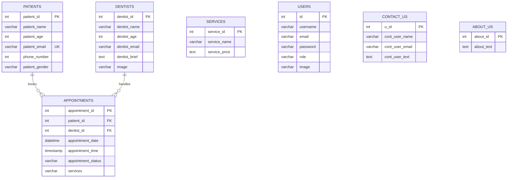

<p align="center">
  <strong>🦷 JUST SMILE</strong><br>
  <em>Dental Clinic Booking & Management System</em>
</p>

<p align="center">
  
  
  
  
  
</p>

<p align="center">
  A full-stack web application for dental clinic appointment management — featuring secure authentication, a patient booking portal, and an admin dashboard with real-time statistics.
</p>

---

## Overview

**Just Smile** is a multi-role web system that serves three user types:

- **Visitors** — Browse dentist profiles, view clinic info, and send inquiries.
- **Patients** — Register, book appointments, and manage their profiles.
- **Admins** — Monitor clinic activity, manage dentists/patients/appointments via a dashboard.

Built as a university project by a 3-person team, it demonstrates end-to-end full-stack development from database design to a polished UI.

---

## Features

### Patient Portal

- **Dentist Directory** — Browse dentist cards with photos, bios, and specialties
- **Appointment Booking** — Select dentist, service, date, and submit a booking
- **Profile Management** — Update name, email, password, and profile photo
- **Contact Form** — Send messages saved directly to the database
- **Dynamic "About Us"** — Content loaded from the database (CMS-style)

### Admin Dashboard

- **Live Statistics** — Dentist count, patient count, upcoming bookings, today's sessions
- **Dentist CRUD** — Add, view, and delete dentist records
- **Appointment Management** — View all bookings, filter by date/doctor, cancel appointments
- **Patient Registry** — Search by name or email, view full patient list

### Authentication & Access Control

- **User Registration** — With profile photo upload (JPG/PNG, max 2 MB)
- **Secure Login** — bcrypt password verification with session + cookie management
- **Role-Based Routing** — Admins redirect to dashboard, patients to their portal
- **Dual Navigation** — Visitors see a public navbar; logged-in patients see their avatar

---

## Architecture

```
┌──────────────────────────────────────────────┐
│               CLIENT  (Browser)              │
│           HTML5 · CSS3 · JavaScript          │
└────────────────────┬─────────────────────────┘
                     │ HTTP
┌────────────────────▼─────────────────────────┐
│              APACHE  (XAMPP)                  │
│                                              │
│   Visitor UI ─── Patient UI ─── Admin Panel  │
│       │              │              │        │
│   ┌───▼──────────────▼──────────────▼───┐    │
│   │         PHP Backend Layer           │    │
│   │  • PDO Prepared Statements          │    │
│   │  • bcrypt Authentication            │    │
│   │  • Session & Cookie Management      │    │
│   │  • Role-Based Access Control        │    │
│   │  • Input Validation                 │    │
│   └──────────────┬──────────────────────┘    │
└──────────────────┼───────────────────────────┘
                   │ PDO / MySQLi
┌──────────────────▼───────────────────────────┐
│          MySQL / MariaDB 10.4                │
│                                              │
│   appointment_system                         │
│   ├── patients       → patient records       │
│   ├── dentists       → doctor profiles       │
│   ├── appointments   → bookings (FK)         │
│   ├── services       → dental services       │
│   ├── users          → auth & roles          │
│   ├── contact_us     → messages              │
│   └── about_us       → CMS content           │
└──────────────────────────────────────────────┘
```

---

## Database Schema



**Key constraints:** Foreign keys on `appointments` cascade on delete/update. Patient email is unique.

---

## Security Highlights

| Layer | Implementation |
|-------|---------------|
| **Password Storage** | bcrypt hashing via `password_hash()` / `password_verify()` |
| **SQL Injection Prevention** | PDO Prepared Statements with `bindParam()` |
| **Email Validation** | Server-side `FILTER_VALIDATE_EMAIL` |
| **File Upload Protection** | MIME type whitelist (JPG/JPEG/PNG) + 2 MB size limit |
| **Session Security** | Full session cleanup + cookie invalidation on logout |
| **Access Control** | Role-based routing — admin vs. patient separation |
| **Input Sanitization** | `htmlspecialchars()` on output, `preg_match()` on names |

---

## Getting Started

### Prerequisites

- [XAMPP](https://www.apachefriends.org/) (Apache + MySQL + PHP 8.x)

### Installation

```bash
# 1. Clone the repository
git clone https://github.com/YOUR_USERNAME/just-smile-dental.git

# 2. Copy to XAMPP htdocs
cp -r just-smile-dental/ C:/xampp/htdocs/Dental
```

3. Start **Apache** and **MySQL** from XAMPP Control Panel.

4. Open **phpMyAdmin** → create database `appointment_system` → import `appointment_system.sql`.

5. If your MySQL credentials differ from `root` / no password, edit `config.php`.

6. Open `http://localhost/Dental/` in your browser.

---

## Project Structure

```
Dental/
├── index.php                    # Home page
├── config.php                   # Database config (PDO)
├── appointment_system.sql       # Schema + seed data
│
├── appontment.php               # Booking form
├── booking.php                  # Dentist cards (visitors)
├── userbooking.php              # Dentist cards (patients)
├── booking_successfully.php     # Confirmation page
├── dentist_info.php             # Dentist detail page
├── patient_home.php             # Patient dashboard
├── contact_us.php               # Contact form
├── about.php                    # About page (dynamic)
├── header.php                   # Navbar (visitors)
├── header_patient.php           # Navbar (patients + avatar)
├── footer.php                   # Footer
│
├── admin/                       # Admin panel
│   ├── index.php                #   Dashboard + statistics
│   ├── doctors.php              #   Dentist CRUD
│   ├── appointment.php          #   Appointment management
│   ├── patient.php              #   Patient registry
│   └── logout.php               #   Secure logout
│
├── login/                       # Authentication
│   ├── login.php                #   Login (bcrypt verify)
│   ├── register.php             #   Registration (bcrypt hash)
│   ├── update_profile.php       #   Profile editor
│   └── uploaded_img/            #   Profile pictures
│
├── css/                         # Stylesheets (9 files)
├── img/                         # Static assets & SVG icons
└── imgs/                        # Dentist photos
```

---

## Future Improvements

- [ ] Unify database drivers (PDO everywhere, replace MySQLi in admin)
- [ ] Add CSRF token protection to all forms
- [ ] Email notifications on booking confirmation
- [ ] Appointment status workflow (pending → confirmed → completed)
- [ ] Client-side form validation
- [ ] Pagination for large data tables
- [ ] REST API layer for mobile app integration

---

## Tech Stack

| Category | Technology |
|----------|-----------|
| Backend | PHP 8.2 |
| Database | MySQL / MariaDB 10.4 |
| Frontend | HTML5, CSS3, JavaScript |
| Server | Apache (XAMPP) |
| Typography | Google Fonts (Inter, Lato, Pacifico) |
| Design | Custom CSS with animations |

---

## Author

- **Mahmood Fahmi Abdo Mohammed Nasher**

## License

This project is open source and available under the [MIT License](LICENSE).
